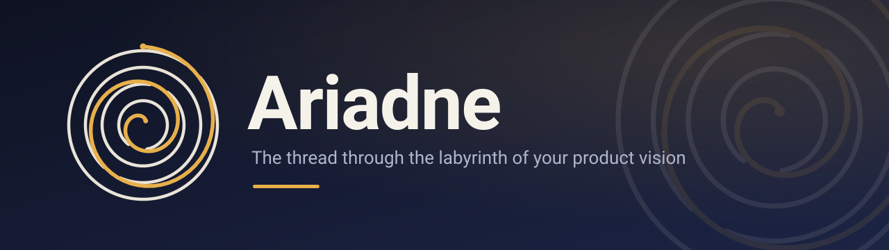

<p align="center">
  
</p>

<p align="center">
  <a href=".github/workflows/validate.yml"></a>
  <a href="LICENSE"></a>
  <a href="agents"></a>
  <a href="claude/commands"></a>
  
</p>

<p align="center">
  <strong>Your AI coding agent is a great builder and a terrible product manager.</strong><br>
  Ariadne is the product-discovery front-end that runs before code, so the agent stays
  faithful to your intent instead of treating the current codebase as the spec.
</p>

---

## The problem

AI coding agents are extraordinary at turning a clear specification into working code. They are bad at finding out what the specification should be.

Ask one to "add an upload flow" and it will produce a plausible upload flow — modeled on whatever the codebase already does, whatever pattern is most common on the internet, and whatever makes the implementation look complete. Requirements get invented to fill gaps. Assumptions get presented as decisions. The current implementation quietly becomes the specification, and you discover the mismatch after the code exists.

The cost is not the code. It is that **the wrong thing gets built quickly, and then defended**. Reviewing generated code for product fidelity is much harder than discovering intent up front.

## What Ariadne does

Ariadne is a three-stage product-discovery pipeline for AI coding agents. Each stage is a separate agent, and each leaves a Markdown artifact you can read, diff, and hand to the next stage.

```
  .ariadne/discovery.md        .ariadne/audit.md         .ariadne/plan.md
  ┌──────────────────┐        ┌─────────────────┐       ┌────────────────┐
  │    DISCOVER      │───────▶│      AUDIT      │──────▶│   ARCHITECT    │
  │  what & why      │        │  is it sound?   │       │  how to build  │
  └──────────────────┘        └─────────────────┘       └────────────────┘
     interviews you            prior art, novelty         repo-aware plan
     finds the workflow        risks, alternatives        thin vertical slices
```

- **Discover** (`ariadne-discover`) — interviews you like a product manager would, converting "this feels awkward" into a canonical workflow, an explicit requirements register, usability gaps, and prioritized open questions.
- **Audit** (`ariadne-audit`) — stress-tests the resulting idea against prior art, novelty, architecture, failure modes, and the strongest competing design.
- **Architect** (`ariadne-architect`) — maps the clarified vision onto the actual repository and produces an implementation-ready plan without writing code.

Use all three, or just Discover — it works alone.

## See it in action

```
You:      The upload flow feels awkward. I expected it to just work.

Ariadne:  What is the user trying to accomplish at that moment?
          (Uncertainty: is "awkward" about the number of steps, the
          wording, or the lack of feedback while it runs?)

You:      They already picked the file. Asking them to confirm again is silly.

Ariadne:  → R7 (latent, high confidence): once a file is selected, the system
            begins the upload without a second confirmation; the user can
            cancel while it runs.
          → C2 (conflict): the current "Review & upload" step exists because
            the API needs a separate commit call. That is an implementation
            artifact, not product intent.
          → Q3 (open): what must remain visible during the upload, and what
            should happen on failure?

          I've written these to .ariadne/discovery.md. Two questions before
          I update the canonical workflow...
```

No code. No architecture. A requirement was extracted, an implementation artifact was named, and an assumption was not silently promoted to a decision.

## Why Ariadne

- **Intent before implementation.** The agent is explicitly forbidden from writing code, producing patches, or turning the session into an engineering plan.
- **Interviewing, not document generation.** It asks small batches of focused questions tied to concrete workflow moments. It does not dump a giant questionnaire or invent requirements to look complete.
- **Five-way epistemic hygiene.** Every claim is tagged **Observed**, **Stated**, **Inferred**, **Uncertain**, or **Conflicting**, with confidence and evidence. Inferences are never presented as settled requirements.
- **Contradictions stay visible.** It surfaces incompatible product models and asks you to choose — rather than picking one and moving on.
- **Explicit anti-convergence.** It assumes the current implementation may have accidentally shaped your workflow, and asks what must remain true even if the interface changes completely.
- **A real artifact.** Every round updates a living `.ariadne/discovery.md`, so the deliverable is tangible and the next stage has something to consume.
- **Tool-agnostic.** Native OpenCode agents, Claude Code slash commands, and a plain prompt you can paste anywhere.

## How it compares

| | **Ariadne** | Requirements-clarity skill | "Write me a PRD" prompt |
|---|---|---|---|
| Runs before code, from intent | ✅ | ⚠️ after a request exists | ⚠️ |
| Interviews instead of generating | ✅ | ✅ | ❌ |
| Distinguishes observed / stated / inferred / uncertain / conflicting | ✅ | ❌ | ❌ |
| Surfaces contradictions instead of resolving them | ✅ | ❌ | ❌ |
| Resists converging on the current implementation | ✅ | ❌ | ❌ |
| Produces a living discovery artifact | ✅ | ✅ PRD | ⚠️ |
| Feeds a downstream planning agent | ✅ | ⚠️ | ⚠️ |
| Scope | product intent | requirement completeness | one-shot document |

## Install

```sh
git clone https://github.com/jbalint/ariadne-product-discovery.git
cd ariadne-product-discovery
./install.sh              # both tools
```

Or without cloning:

```sh
curl -fsSL https://raw.githubusercontent.com/jbalint/ariadne-product-discovery/main/install.sh | sh -s -- --opencode
```

| Flag | Effect |
|---|---|
| `--opencode` | Install the three agents into `~/.config/opencode/agents/` |
| `--claude` | Install the three slash commands into `~/.claude/commands/` |
| `--all` | Both (default) |
| `--dry-run` | Print what would be written, change nothing |
| `--uninstall` | Remove Ariadne; leaves `.ariadne/` project artifacts alone |

<details>
<summary>Manual installation</summary>

**OpenCode** — copy `agents/*.md` into `~/.config/opencode/agents/` (V2) or `~/.config/opencode/agent/` (V1-compatible).

**Claude Code** — copy `claude/commands/*.md` into `~/.claude/commands/`.

**Anything else** (Cursor, Windsurf, a chat window) — copy the body of the relevant file in `agents/`, drop the YAML frontmatter, and use it as the system prompt, custom mode, or rule.

</details>

## Quick start

**OpenCode** — open the agent picker, choose `ariadne-discover`, and describe what you are building:

```
I'm building a CLI that turns a folder of screenshots into a design spec.
The current version technically works but the flow feels clunky.
```

**Claude Code**:

```
/ariadne-discover a folder-of-screenshots to design-spec CLI
```

Then follow the pipeline:

```
/ariadne-audit      # once discovery.md reflects your intent
/ariadne-architect  # once the idea has survived the audit
```

## How it works

Ariadne maintains a five-section living document at `.ariadne/discovery.md`:

1. **Product intent** — who it is for, the job, the feel, the emerging principles.
2. **Canonical workflow** — the happy path plus meaningful alternates and recovery paths, stage by stage.
3. **Requirements register** — explicit vs. latent, with evidence, confidence, and status.
4. **Usability gaps** — current vs. intended behavior, and which principle each gap violates.
5. **Open questions** — prioritized by leverage, with the evidence that would resolve each one.

Every round follows the same loop:

> state the current belief → name the most consequential uncertainty → ask 2–3 focused questions → update the document → report what changed

When evidence conflicts, it uses a fixed priority: **your clarified intent** → observable user goals → documented product decisions → current behavior → incidental implementation details. The current behavior is fourth, not first, on purpose.

## The three agents

| Agent | Mode | Writes | Job |
|---|---|---|---|
| `ariadne-discover` | primary | `.ariadne/discovery.md` | Interview you into a precise product intent and workflow |
| `ariadne-audit` | primary | `.ariadne/audit.md` | Prior art, novelty map, risks, alternatives |
| `ariadne-architect` | primary | `.ariadne/plan.md` | Repo-aware plan: slices, tasks, acceptance criteria |

Each agent has write access to its own `.ariadne/` artifact and nothing else. Discovery cannot edit code or run shell commands. The architect can inspect the repo but must ask before running shell commands.

## Design principles

Ariadne is built on a few opinions worth stating plainly:

- **The product owner is the source of truth, not the codebase.** Existing behavior is evidence, not intent.
- **Uncertainty is information.** A marked unknown is more valuable than a confident guess.
- **Fewer, better questions.** A small batch tied to a concrete moment beats a comprehensive questionnaire.
- **The deliverable is understanding, not a document.** The Markdown is a byproduct of getting the model right.
- **Discovery ends when you recognize your own vision**, not when the template is full.

## Roadmap

- [x] Three-stage pipeline with per-stage artifacts
- [x] OpenCode agents + Claude Code commands
- [ ] Session memory across discovery rounds
- [ ] Structured YAML/JSON output for downstream agents
- [ ] Issue-tracker import (seed discovery from existing tickets)
- [ ] Cursor rules and additional tool ports
- [ ] Example gallery from real sessions

See [`docs/roadmap.md`](docs/roadmap.md) for details.

## Documentation

- [`docs/examples.md`](docs/examples.md) — full worked sessions
- [`docs/methodology.md`](docs/methodology.md) — the reasoning discipline in depth
- [`docs/comparison.md`](docs/comparison.md) — positioning against adjacent tools
- [`docs/roadmap.md`](docs/roadmap.md) — what is next

## Contributing

Issues and pull requests are welcome. The most useful contributions are **real discovery transcripts** (with anything sensitive removed) and **failure cases** where the agent converged too early or accepted an implementation artifact as a requirement. See [`CONTRIBUTING.md`](CONTRIBUTING.md).

## License

MIT — see [`LICENSE`](LICENSE).
